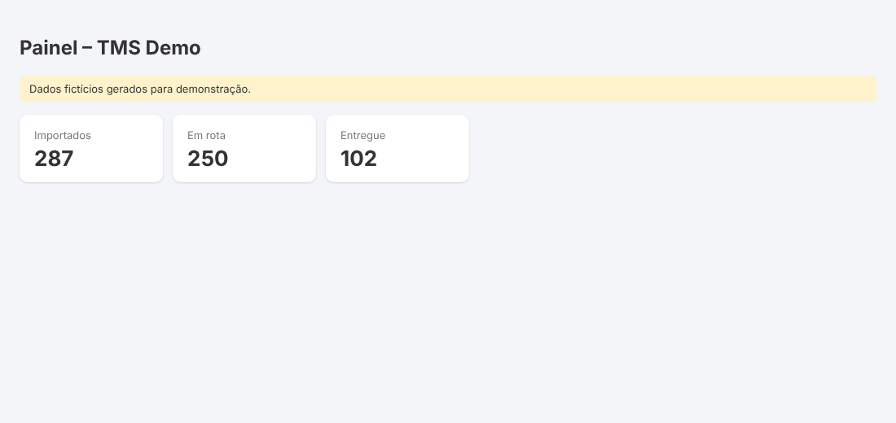
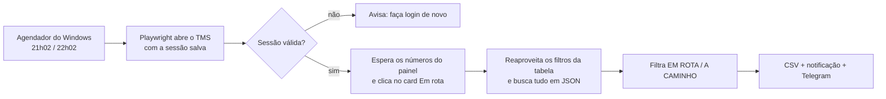

# 🚚 Monitor de Pedidos Em Rota

Automação em **Python + Playwright** que confere, num TMS (sistema de gestão de transportes) web,
quais pedidos do dia **continuam "em rota" no marketplace depois do horário em que deveriam ter sido entregues**,
gera uma planilha e avisa a equipe. Roda sozinha às 21h e 22h pelo Agendador de Tarefas do Windows.

> Projeto nascido de uma tarefa real do meu trabalho como jovem aprendiz no setor operacional de uma transportadora.
> Este repositório usa um **TMS simulado com dados 100% fictícios**: nenhum dado, endereço ou credencial real está aqui.



---

## 🧩 O problema

Toda noite, entre 21h e 22h, alguém da operação precisava:

1. abrir o painel do TMS e clicar no card **"Em rota"**;
2. percorrer centenas de pedidos, de 50 em 50, olhando a coluna **Marketplace**;
3. anotar quais ainda estavam **"EM ROTA"** ou **"A CAMINHO"**, ou seja, pedidos que já deveriam ter sido entregues;
4. depois investigar o motivo de cada um.

Os passos 1 a 3 são repetitivos, lentos e fáceis de errar. O passo 4 precisa de uma pessoa.

## 💡 A solução

O monitor automatiza os passos 1 a 3 e entrega a lista pronta para a pessoa investigar:

```
🚚 21:02 – 104 pedidos ainda em rota (de 250 em rota no TMS)

EM ROTA DE ENTREGA: 69 | A CAMINHO (MERCADO LIVRE): 35
MERCADO ENVIO FLEX: 40 | AVULSO: 36 | SHOPEE: 28

100001 · BR914655221101 · CEP 07912-032 · EM ROTA DE ENTREGA
100003 · 68175080694 · CEP 05557-828 · EM ROTA DE ENTREGA
...
```

- 📄 **Planilha CSV** com todos os pedidos pendentes (abre direto no Excel)
- 🔔 **Notificação no Windows** e, opcionalmente, **mensagem no Telegram**
- ⏰ **Agendado** de segunda a sexta, às 21h02 e 22h02
- 🔒 **Somente leitura**: não altera nada no sistema

## ⚙️ Como funciona



### Decisões técnicas

| Decisão | Por quê |
|---|---|
| **Buscar os dados em JSON em vez de ler a tela** | A tabela usa DataTables em modo *server-side* (50 linhas por página). Com `page.evaluate`, o script roda JS dentro da própria página, reaproveita os filtros que o card aplicou e pede **todas as linhas numa única requisição**. É mais rápido e não quebra se o layout mudar. |
| **Clicar no card, e não montar a URL na mão** | O card envia os filtros (status, data, filial) por um POST que fica guardado na sessão. Clicar no card garante exatamente o mesmo resultado que um usuário veria. |
| **Esperar o número do card carregar** | Os números do painel chegam via AJAX depois da página abrir, e o card **ignora cliques enquanto mostra 0**. Esse foi o primeiro bug encontrado no uso real. |
| **Sessão salva (`launch_persistent_context`)** | O login é feito uma vez, manualmente. **Nenhuma senha fica no código** nem em arquivo. |
| **Sem nome de destinatário no Telegram** | O resumo leva só remessa, pedido, CEP e status. Dados pessoais ficam apenas na planilha local. |
| **Funções puras separadas do navegador** | Filtro, resumo e CSV são testados com `pytest` sem precisar abrir navegador. |

## 🚀 Rodando a demonstração

Pré-requisito: **Python 3.10+** (no Windows, marque *"Add python.exe to PATH"* na instalação).

```bash
git clone https://github.com/SEU-USUARIO/monitor-pedidos-em-rota.git
cd monitor-pedidos-em-rota

python -m venv .venv
.venv\Scripts\activate            # Linux/Mac: source .venv/bin/activate
pip install -r requirements-dev.txt
python -m playwright install chromium
copy config.exemplo.ini config.ini  # Linux/Mac: cp config.exemplo.ini config.ini
```

Em um terminal, suba o **TMS simulado**:

```bash
python demo/servidor_simulado.py      # http://127.0.0.1:8000
```

Em outro terminal:

```bash
python monitor_em_rota.py --login     # faça login (qualquer usuário/senha na demo)
python monitor_em_rota.py --visivel   # roda a verificação mostrando o navegador
```

> No Windows também dá para usar os atalhos da pasta `scripts/`: `instalar.bat` → `iniciar_demo.bat` → `fazer_login.bat` → `testar.bat` → `agendar.bat`.

### Testes

```bash
pytest
```

### Telegram (opcional)

1. Crie um bot com o **@BotFather** e copie o token.
2. Mande uma mensagem para o bot e pegue seu `chat_id` em `https://api.telegram.org/bot<TOKEN>/getUpdates`.
3. Preencha `token` e `chat_id` no `config.ini`.

## 📁 Estrutura

```
monitor-pedidos-em-rota/
├── monitor_em_rota.py        # automação principal
├── demo/
│   └── servidor_simulado.py  # TMS fake: login, painel, tabela DataTables
├── tests/
│   └── test_regras.py        # testes do filtro, resumo e CSV
├── scripts/                  # atalhos .bat para Windows (instalar, testar, agendar)
├── docs/                     # imagens do README
├── config.exemplo.ini
├── requirements.txt
└── requirements-dev.txt
```

## 🛣️ Próximos passos

- [ ] Comparar a verificação das 21h com a das 22h e destacar o que não mudou
- [ ] Agrupar pendências por região/CEP
- [ ] Alerta só quando passar de um limite configurável
- [ ] Gráfico diário de pedidos pendentes

## 🛠️ Tecnologias

Python · Playwright · DataTables (engenharia reversa da API da tabela) · pytest · Telegram Bot API · Agendador de Tarefas do Windows

## 👤 Autor

**Vinicius Furtado**: estudante de ADS na FIAP School, futuro engenheiro de software.
[LinkedIn](https://www.linkedin.com/in/SEU-PERFIL) · [GitHub](https://github.com/SEU-USUARIO)

Licença [MIT](LICENSE).
